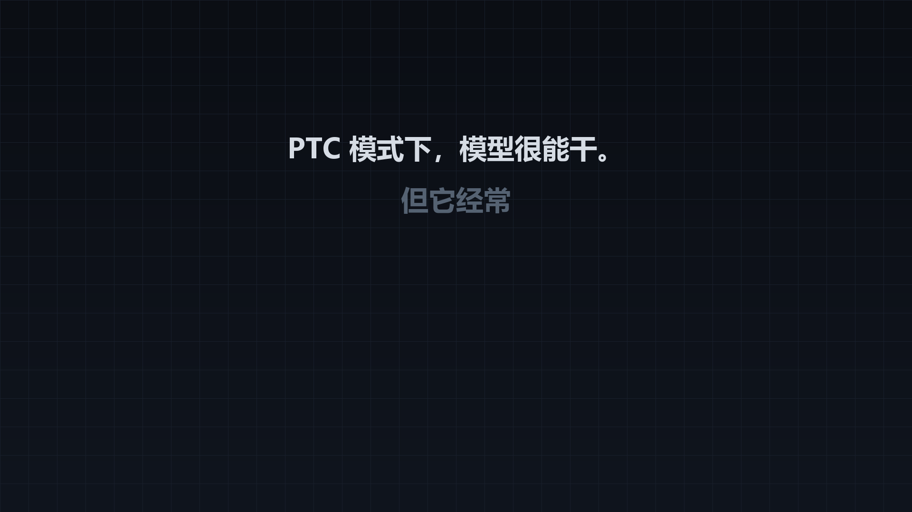

# PTC Discipline / PTC 纪律

一个 DSH agent preset：在 PTC 模式（`run_code` + 生成的 SDK 是唯一的代码入口）之上，
再加一道**强制执行**的纪律闸门——没有目标、没有进行中的待办，任何工具调用都过不去。

A DSH agent preset that layers a hard enforcement gate on top of PTC mode: every tool call is
refused until the session holds an active goal and an in-progress todo.

```
npx dsh plugin add yuan-source-666/dsh-ptc-discipline
```

装好后在新建会话里选 **PTC 纪律** 这个 preset 即可生效。

## 宣传视频



[▶ 观看 31 秒宣传片](docs/media/ptc-discipline-promo.mp4) · [轻量 GIF 预览](docs/media/preview.gif)

## 它做什么

| | |
| --- | --- |
| 呈现方式 | `@deepseek-ai/dsh-agent-tool-presentation` 的 `mode: ptc`——模型只能直接调用 `run_code`，其余工具通过生成的 SDK 访问 |
| 闸门 | 每次工具调用（含 `run_code` 里的 `await tools.xxx()` 子调用）都过 `ctx.tools.guard()` |
| 放行条件 | 存在 `active` 的 goal，且 todo 列表非空、至少一条 `in_progress` |
| 顺序 | 固定为 `create_goal` → `todo_write` → 其余一切 |

被拒时返回的是可执行的原因，例如：

```
Discipline gate: no goal (call create_goal with the verifiable end condition); no todo list
(call todo_write with the complete task list). Seed it from inside run_code first — create_goal,
then todo_write, then call "write".
```

## 闸门规则

| 条件 | 不满足时的报错 |
| --- | --- |
| 存在 `active` 的 goal | `no goal (call create_goal …)` / `goal is "paused" (…)` |
| todo 列表非空 | `no todo list (call todo_write …)` |
| 至少一条 todo 是 `in_progress` | `no todo is in_progress …` / `every todo is completed …` |

### 三类豁免

- **`run_code` 本身**——PTC 的唯一直接入口，拦住它就是死锁。
- **引导工具**——`create_goal` / `get_goal` / `update_goal` / `todo_write` /
  `ask_user_question` / `skill` / `present`。不建纪律的工具不该被纪律拦住。
- **非 root agent**——`create_goal` 要求 root agent 当前 turn 有真人消息，子 agent 永远满足不了；
  不豁免会让所有 subagent 立刻死锁。

### 服务缺失时 fail-open

goal / sessionProjections 服务不可用时闸门不拦（而不是全拦），
避免在没装 goal、todo 相关插件的组合里把 agent 彻底锁死。

## 为什么用 guard，而不是只写提示词

`ctx.tools.guard()` 挂在本 preset 的 **preset scope** 上。preset scope 是每个加入该 preset 的
agent scope 的祖先，`guardReason` 沿 scope chain 由远及近求值，所以它精确覆盖「这个 preset 的
所有 agent」，不外溢到别的 preset，也不需要任何全局状态。

守卫在 `tools/pre-execute` waterfall **之后**执行，且任何守卫都不能强制放行另一个守卫的拒绝
——这正是硬约束该在的位置。PTC 的 SDK 子调用走
`scheduler.prepare` → `prepareExecution` → `preExecute` → `guardReason`，和原生调用同一条
管道，所以 `await tools.write(...)` 同样过闸。

## 安装

```sh
npx dsh plugin add yuan-source-666/dsh-ptc-discipline
```

或者在支持 bundle 的应用里用 `plugin_manager`：

```jsonc
{ "action": "install_bundle", "target": "yuan-source-666/dsh-ptc-discipline" }
```

卸载：

```jsonc
{ "action": "remove_bundle", "target": "dsh-ptc-discipline" }
```

## 配置

```yaml
- id: ptc-discipline
  name: 'dsh-ptc-discipline'
  config:
    requireGoal: true          # 默认 true
    requireTodo: true          # 默认 true
    requireActiveTodo: true    # 默认 true；关掉只要求列表非空
    bootstrapTools: [ ... ]    # 默认见上表
    sectionText: "..."         # 替换写进系统提示词的那段纪律说明
```

## 文件

```
.
├── package.json          # dsh.bundle.patch 清单 + 图标/测试入口
├── cordis.patch.yml      # preset 声明：24 个插件行，其中一行是本包
├── index.js              # 守护插件：提示词段 + tools.guard
├── locale/{en,zh}.json   # 插件管理器里的标题与描述
├── icon.svg
├── assets/icon-180.png   # 市场卡片图标
├── test/gate.test.mjs    # 闸门单测（假 Cordis 上下文，10 个场景）
└── README.md
```

## 测试

```sh
npm test
```

`test/gate.test.mjs` 用假 Cordis 上下文断言 10 个场景，无外部依赖：

```
ok  empty session (nothing seeded)      # write/bash 拒；引导工具与 run_code 放行
ok  goal active, no todos               # write 拒
ok  goal active, todos all pending      # write 拒
ok  goal active, one in progress        # write/bash 放行
ok  all todos completed                 # write 拒
ok  goal paused                         # write 拒
ok  goal complete                       # write 拒
ok  subagent (non-root)                 # write/bash 放行（豁免）
ok  goal/todo services absent (fail open)
ok  prompt section                      # name/order/interpolate 校验
```

## 兼容性（DSH 0.2.2+）

本预设跟随 DSH 0.2.2 的官方 `ptc` 预设做了对齐，闸门逻辑**完全未改动**：

| 项目 | 0.2.2 的变化 | 本预设的处理 |
| --- | --- | --- |
| `dsh-tool-subagent-control/list-agents` | 该子路径已从 `exports` 移除，`list_agents` 并入主包注册 | 删除子路径行，保留 `dsh-tool-subagent-control` 主包行 |
| `modelSelectionSettings` | 更名为 `modelSelection`，并新增 `modelDiscovery` | 改用新键名 |
| `dsh-tool-executor-ptc` | 官方 ptc 预设新增 | 一并加入 |

> 注意：如果删掉 `dsh-tool-subagent-control` 整行（而不只是 `list-agents` 子路径），
> 子 agent 的 `send_message` / `interrupt_agent` 控制工具会一并消失，子 agent 只能
> 一次性返回结果、无法再追问或中断。

## 已知边界

- **todo 每个新 turn 会清空**（`todos` projection 在 `turn/start` 重置），goal 跨 turn 存活。
  所以第二个请求开始时闸门会重新要求 `todo_write`——这是刻意的。
- **只有 `run_code` 一个直接入口**：被拒时模型必须再写一个 `run_code` 程序把纪律补上，
  系统提示词里给了现成的两行种子代码。
- **plan 模式会打架**：plan-mode 的 guidance 说明规划阶段别用 `todo_write`，但闸门此时仍要求
  todo。在 plan 下应当给这个 preset 关掉 `requireTodo`，或先建一个「写计划」的 todo。
- **单测只覆盖闸门逻辑**：假上下文验证的是判定与豁免，不覆盖真实会话里的完整链路。

## License

MIT
